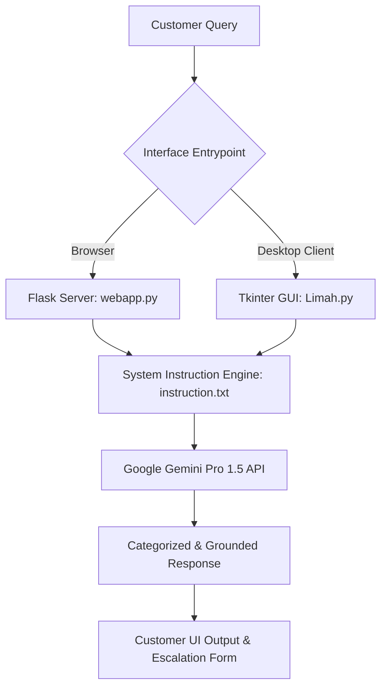

# ⚡ CellPay Customer Assistant AI

[](https://www.python.org/)
[](https://deepmind.google/technologies/gemini/)
[](https://flask.palletsprojects.com/)
[](https://docs.python.org/3/library/tkinter.html)
[](LICENSE)

> An enterprise conversational AI assistant built for **CellPay**, a digital utility platform simplifying electricity token purchases and payment automation in Nigeria. The system features a dual interface—a **Flask web application** and a **Tkinter desktop GUI**—powered by Google Gemini Pro 1.5 with customized system instructions for structured customer support and transaction escalation.

---

## 📌 Features & Capabilities

- **Intelligent Customer Triage:** Categorizes incoming customer interactions into compliments, general product enquiries, or transaction issues.
- **Structured Complaint Escalation:** When a user reports a failed electricity transaction or delayed token generation, the assistant methodically collects essential audit parameters:
  - Account/Customer Name
  - Meter Number
  - Customer Category (Prepaid vs. Postpaid)
  - Phone Number for follow-up
  - Transaction Amount (₦), Date, and Timestamp
- **Anti-Hallucination Guardrails:** Guided by explicit negative constraints: if transaction details or policy specifics are outside the provided context, the model avoids speculation and provides designated escalation channels.
- **Dual Deployment Interfaces:**
  - **Web Application (`webapp.py`):** Clean HTML/CSS chat interface served via Flask.
  - **Desktop Application (`Limah.py`):** Native Tkinter desktop client for customer support staff and offline office terminals.

---

## 🛠️ System Architecture



---

## 📂 Project Structure

```text
Customer-Assistant-AI/
├── webapp.py            # Flask backend serving the web-based chat application
├── Limah.py             # Desktop GUI client built with Tkinter
├── Aina.py              # Modular conversational agent script
├── instruction.txt      # System prompt and domain instructions
├── templates/
│   └── index.html       # Responsive web chat interface template
├── .env.example         # Template for environment configuration
├── requirements.txt     # Python dependency specifications
└── README.md            # Project documentation and setup guide
```

---

## 🚀 Installation & Setup

### 1. Prerequisites
- Python 3.9+
- A Google Gemini API Key from [Google AI Studio](https://aistudio.google.com/)

### 2. Clone and Setup Environment
```bash
git clone https://github.com/100kuta/Customer-Assistant-AI.git
cd Customer-Assistant-AI

python -m venv .venv
source .venv/bin/activate  # On Windows: .venv\Scripts\activate

pip install -r requirements.txt
```

### 3. Environment Configuration
Copy the template environment file and insert your API key:
```bash
cp .env.example .env
```
Edit `.env`:
```ini
GEMINI_API_KEY=your_actual_gemini_api_key_here
```

### 4. Running the Application

#### Option A: Web Application
```bash
python webapp.py
```
Open `http://localhost:5000` in your web browser.

#### Option B: Desktop GUI Application
```bash
python Limah.py
```
A native desktop window will launch for direct interactive chatting.

---

## 📞 Support & Escalation Configuration

The system prompt in `instruction.txt` can be easily configured with production organization details:
- **Support Email:** `support@example.ng`
- **Customer Care Line:** `+234 (0) 800-EXAMPLE`
- **Headquarters:** Jos, Plateau State, Nigeria

---

## 📜 License

This project is licensed under the MIT License - see the [LICENSE](LICENSE) file for details.
